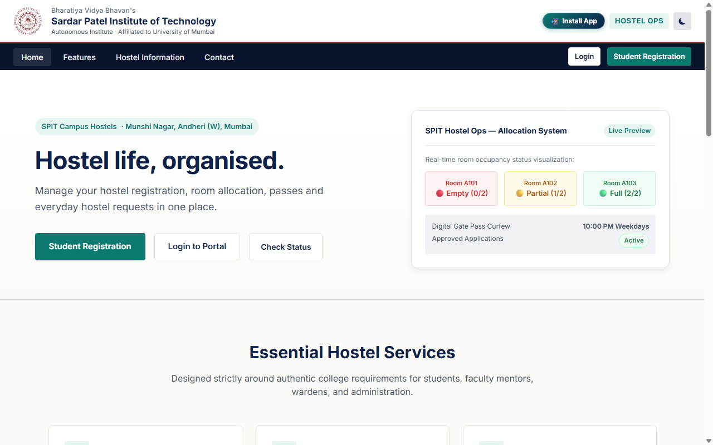
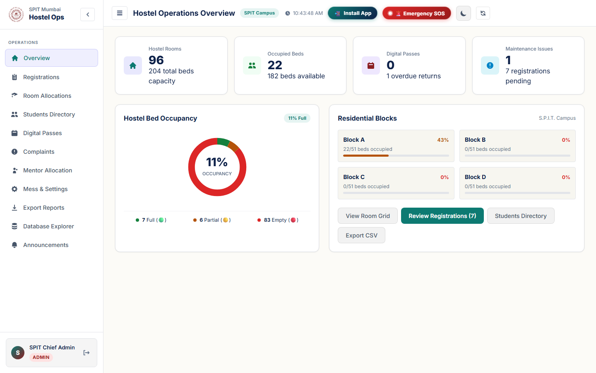
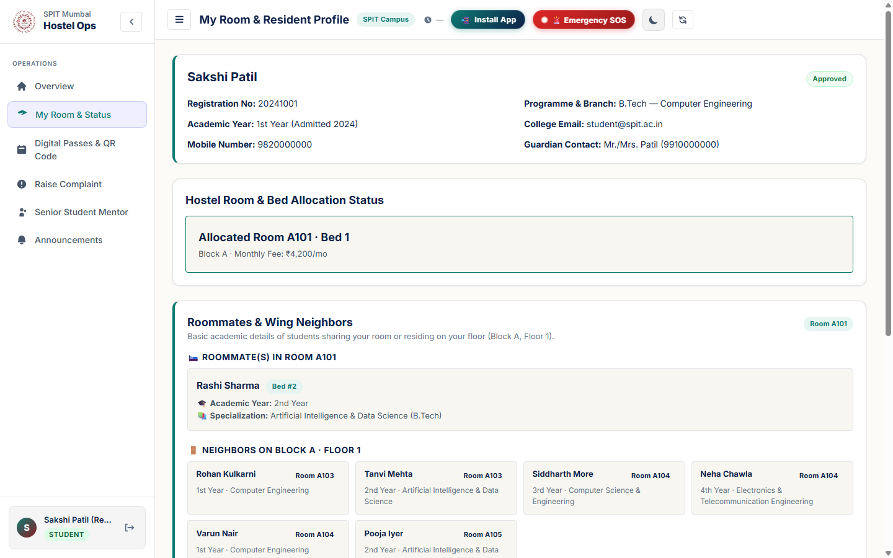
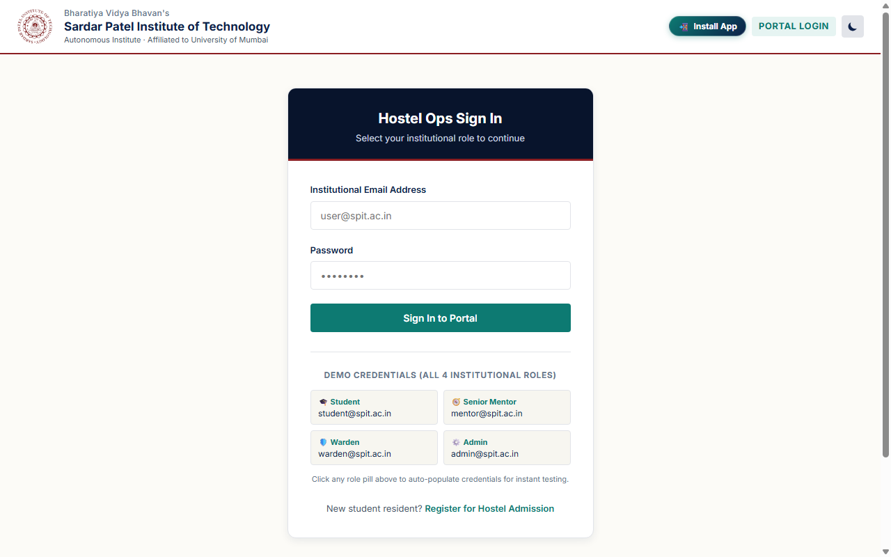

<div align="center">


# SPIT Hostel Ops
### Bharatiya Vidya Bhavan's Sardar Patel Institute of Technology, Mumbai
**Autonomous Institute Affiliated to the University of Mumbai · Munshi Nagar, Andheri (W)**

[](https://spit-hostel-ops.vercel.app)
[](https://nodejs.org/)
[](https://www.mongodb.com/)
[](https://spit-hostel-ops.vercel.app)
[](LICENSE)

<br/>

**A modern, production-ready Hostel Operations & Digital Gate Pass Management System tailored specifically for SPIT campus hostels.**

[🌐 Launch Live Web Application](https://spit-hostel-ops.vercel.app) · [📖 Handover Guide](SPIT_HANDOVER_GUIDE.md) · [🗄️ Database Schema](database/SCHEMA.md)

</div>

---

## 📸 Application Showcase

### 1. Institutional Landing Page & PWA Portal
> Modern landing portal showcasing campus hostel facilities, live room availability cards, and one-tap Progressive Web App (PWA) installation.

<div align="center">
  
</div>

<br/>

### 2. Chief Admin & Warden Operations Dashboard
> Unified operations command centre featuring live KPI cards, interactive SVG bed occupancy donut chart, residential block health metrics, and emergency SOS trigger.

<div align="center">
  
</div>

<br/>

### 3. Resident Student Portal & Allocation Profile
> Dedicated student view displaying approved room assignment (Room A101 / Bed 1), wing neighbors, hostel fee breakdown, and digital pass management.

<div align="center">
  
</div>

<br/>

### 4. Institutional Single Sign-On Portal
> Secure role-based login gateway with quick-switch demo credentials for all 4 institutional roles.

<div align="center">
  
</div>

---

## ⚡ Core Features

- 🏢 **Smart Room & Bed Allocation Engine**
  - Real-time room status tracking with color-coded occupancy indicators:
    - 🔴 **Empty** (0 occupants)
    - 🟡 **Partial** (Beds available)
    - 🟢 **Full** (Capacity reached)
  - Block-wise and floor-wise distribution across residential wings.
  - Automatic collision prevention ensuring no double-bed allocations.

- 📱 **Digital Outing & 2D QR Gate Passes**
  - Paperless leave & day pass requests submitted directly from the student dashboard.
  - Dynamic 2D scannable QR Code generation containing encrypted pass token, student roll number, destination, and return curfew.
  - Automated curfew compliance tracking with real-time overdue alerts for hostel wardens.

- 👥 **Four-Tier Role-Based Access Control (RBAC)**
  - **Chief Administrator**: Full system administration, room inventory configuration, student admission reviews, database explorer, audit logs, and staff provisioning.
  - **Hostel Warden**: Nightly curfew verification, pending outing pass approvals/rejections, maintenance escalation, and block occupancy reports.
  - **Faculty / Senior Mentor**: Mentee tracking, resident academic checks, meeting logs, and student pastoral support.
  - **Resident Student**: Allocated room profile, roommate academic directory, mess menu preferences, digital QR gate pass generation, and maintenance ticketing.

- 🚨 **Emergency SOS Campus Alert**
  - Instant one-tap emergency broadcast system sending high-priority alerts with student location and room number to wardens and campus security.

- 🍲 **Mess & Dining Management**
  - Daily menu schedule viewer, meal preference selections, and mess rebate leave tracking.

- 🗄️ **MongoDB Database Explorer**
  - Direct administrative viewer to inspect MongoDB collections (`rooms`, `students`, `passes`, `complaints`, `sessions`, `settings`) without needing Compass.

- 📲 **Progressive Web App (PWA) Offline Ready**
  - Installable on Android, iOS, Windows, and macOS with service worker offline caching and responsive mobile drawer navigation.

---

## 🔐 Master Demo Credentials

Use any of the pre-configured institutional test accounts to explore the system:

| Role | Institutional Email | Password | Access Privileges |
| :--- | :--- | :--- | :--- |
| **Administrator** | `admin@spit.ac.in` | `Admin@123` | Full access: All modules, Database Explorer, Settings |
| **Hostel Warden** | `warden@spit.ac.in` | `Warden@123` | Gate passes, curfew tracking, room inspections, complaints |
| **Faculty Mentor** | `mentor@spit.ac.in` | `Mentor@123` | Mentee profiles, pastoral sessions, student contact info |
| **Resident Student** | `student@spit.ac.in` | `Student@123` | Personal room status, roommates, 2D QR passes, SOS alert |

---

## 🛠️ Architecture & Tech Stack

```
                               ┌─────────────────────────────────────────┐
                               │       Client (Browser / PWA)            │
                               │  HTML5 · Vanilla CSS (SPIT Tokens)      │
                               │  Vanilla JavaScript (Modular ES6+)      │
                               │  Service Worker · QR Server Engine      │
                               └────────────────────┬────────────────────┘
                                                    │ HTTPS / REST API
                               ┌────────────────────▼────────────────────┐
                               │           Backend Web Server            │
                               │  Node.js · Express.js · JWT Auth        │
                               │  Bcrypt · Input Validation (CORS)       │
                               └────────────────────┬────────────────────┘
                                                    │ Mongoose ODM
                               ┌────────────────────▼────────────────────┐
                               │        Cloud Database Layer             │
                               │  MongoDB Atlas Replica Set Cluster      │
                               └─────────────────────────────────────────┘
```

| Layer | Technology | Purpose |
| :--- | :--- | :--- |
| **Frontend** | HTML5, Vanilla CSS3, Vanilla JS | High-performance, zero-bloat UI with institutional SPIT design tokens |
| **Styling** | Custom Design System (`spit.css`) | Institutional Navy (`#0b2545`), SPIT Maroon (`#7a1c1c`), Teal (`#008080`) |
| **Backend** | Node.js, Express.js | Robust RESTful API architecture with centralized error handling |
| **Database** | MongoDB Atlas (Mongoose ODM) | Document storage for rooms, residents, passes, and audit trails |
| **Auth** | JSON Web Tokens (JWT) + BcryptJS | Secure cryptographic password hashing and role-based guards |
| **Hosting** | Vercel Serverless | Global edge deployment with automatic SSL certificate management |

---

## 📁 Repository Structure

```
OPS/
├── backend/                      # Express REST API Server
│   ├── src/
│   │   ├── config/               # Database connection (Mongoose/Atlas)
│   │   ├── controllers/          # Business logic handlers
│   │   ├── middleware/           # JWT authentication, role guards
│   │   ├── models/               # Mongoose schemas (Room, Student, Pass, etc.)
│   │   ├── routes/               # Modular Express API routers
│   │   ├── utils/                # Database seed scripts
│   │   └── server.js             # Main server bootstrap
│   ├── .env                      # Environment configuration
│   └── package.json
│
├── frontend/                     # Progressive Web Application
│   ├── assets/                   # Institutional crests, icons, PWA manifests
│   ├── css/
│   │   ├── spit.css              # Core SPIT institutional design tokens & components
│   │   └── dashboard.css         # Dashboard layout & widget styles
│   ├── js/
│   │   ├── api.js                # Universal API client & fallback handlers
│   │   ├── login.js              # Authentication controller & demo login
│   │   ├── dashboard.js          # Unified controller for all 4 roles
│   │   └── register.js           # Student hostel registration workflow
│   ├── index.html                # Public landing & information portal
│   ├── login.html                # Secure institutional login page
│   ├── dashboard.html            # Main multi-role app dashboard
│   ├── manifest.json             # PWA web app manifest
│   └── sw.js                     # PWA Service Worker caching
│
├── docs/                         # Documentation & Visual Assets
│   └── screenshots/              # High-resolution application screenshots
│
├── database/
│   └── SCHEMA.md                 # Complete schema reference
│
├── SPIT_HANDOVER_GUIDE.md        # Official institutional deployment guide
└── README.md                     # Project documentation (this file)
```

---

## 🚀 Local Development Setup

### 1. Prerequisites
- **Node.js** (v18.0.0 or higher recommended)
- **Git**
- **MongoDB** (Local instance or MongoDB Atlas URI)

### 2. Clone the Repository
```bash
git clone https://github.com/sakshihonamane5-design/OPS.git
cd OPS
```

### 3. Configure Backend Environment
Navigate to `backend/` and verify the `.env` configuration:
```env
PORT=5000
MONGODB_URI=your_mongodb_connection_string
JWT_SECRET=your_jwt_secret_key
NODE_ENV=development
```

### 4. Install Dependencies & Seed Database
```bash
cd backend
npm install
npm run seed       # Populates SPIT hostel demo rooms, students, and users
npm run dev        # Starts API server with hot-reload on http://localhost:5000
```

### 5. Launch Frontend
Serve the `frontend/` directory using any local server:
```bash
# In the root project directory:
npx serve frontend
# OR open frontend/index.html in modern browser
```

---

## 👥 Project Team & Contributors

This project was collaboratively built by:

<table align="center">
  <tr>
    <td align="center" width="33%">
      <a href="https://github.com/sakshihonamane5-design">
        <br />
        <br />
        <b>@sakshihonamane5-design</b>
      </a>
    </td>
    <td align="center" width="33%">
      <a href="https://github.com/rashir5">
        <br />
        <br />
        <b>@rashir5</b>
      </a>
    </td>
    <td align="center" width="33%">
      <a href="https://github.com/aishwarya2927">
        <br />
        <br />
        <b>@aishwarya2927</b>
      </a>
    </td>
  </tr>
</table>

---

## 📄 Institutional License

Developed for **Bharatiya Vidya Bhavan's Sardar Patel Institute of Technology (SPIT)**.  
Released under the [MIT License](LICENSE).
